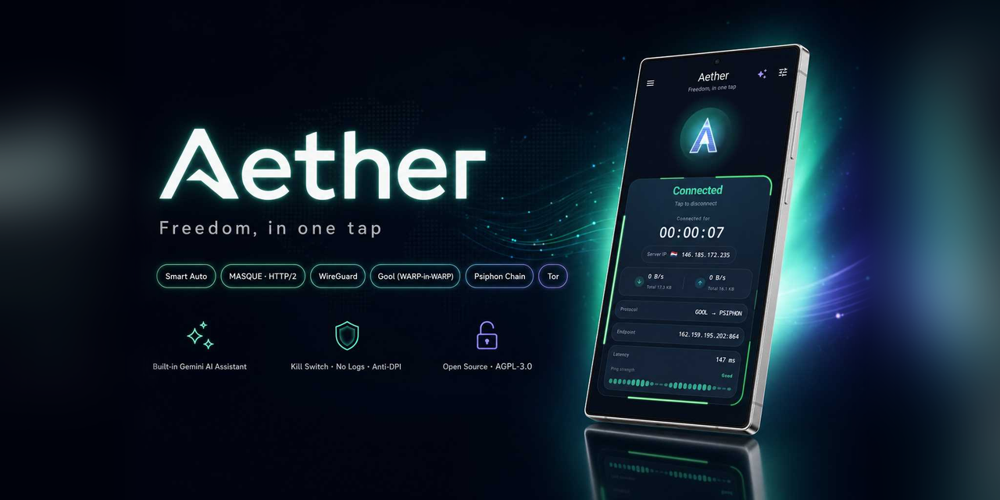

> **نسخهٔ 1.6.0:** [یادداشت انتشار](.github/release-notes.md) · [جزئیات تغییرات](docs/RELEASE_1.6.0.fa.md) · [تاریخچهٔ تغییرات](CHANGELOG.md)

<p align="center">
  
</p>

<h1 align="center">Aether Mobile</h1>

<p align="center">
  کلاینت VPN اندروید با طراحی تیرهٔ <b>Material You</b>؛ موتور Aether، Tor، سایفون و Xray
  <b>داخل خود برنامه</b> هستند.
</p>

<p align="center">
  <a href="README.fa.md">🇮🇷 فارسی</a> · <a href="README.md">🇬🇧 English</a>
</p>

<p align="center">
  
  
  
  
</p>

---

<div dir="rtl" align="right">

## فهرست

- [معرفی](#معرفی)
- [امکانات](#امکانات)
- [حالت‌های اتصال](#حالتهای-اتصال)
- [تازه‌های نسخهٔ 1.6.0](#تازههای-نسخهٔ-160)
- [کانفیگ‌های سفارشی](#کانفیگهای-سفارشی)
- [تنظیمات اسکن آی‌پی تمیز](#تنظیمات-اسکن-آیپی-تمیز)
- [شروع کار](#شروع-کار)
- [راهنمای تنظیمات](#راهنمای-تنظیمات)
- [کاشی تنظیمات سریع و ویجت](#کاشی-تنظیمات-سریع-و-ویجت)
- [اشتراک‌گذاری VPN با دستگاه‌های دیگر](#اشتراکگذاری-vpn-با-دستگاههای-دیگر)
- [دستیار هوش مصنوعی Gemini](#دستیار-هوش-مصنوعی-gemini)
- [حریم خصوصی](#حریم-خصوصی)
- [ممیزی امنیتی](#ممیزی-امنیتی)
- [به‌روزرسانی و امضای برنامه](#بهروزرسانی-و-امضای-برنامه)
- [ساخت برنامه](#ساخت-برنامه)
- [پیش‌نیازها](#پیشنیازها)
- [تاریخچهٔ تغییرات](#تاریخچهٔ-تغییرات)
- [سپاس و مجوز](#سپاس-و-مجوز)

## معرفی

Aether Mobile موتور Aether را روی گوشی اجرا می‌کند و یک `VpnService` اندروید بالا
می‌آورد. هستهٔ تانل داخلی (`hev-socks5-tunnel`) همهٔ بسته‌ها را از رابط VPN به پراکسی
SOCKS5 محلی موتور می‌فرستد؛ بنابراین به برنامهٔ دوم (مثل v2rayNG) نیازی نیست.

<div dir="ltr">

```text
Your apps ─► Android VPN (TUN) ─► hev-socks5-tunnel ─► 127.0.0.1:1819 ─► Aether engine ─► Internet
```

</div>

موتور به شبکهٔ Cloudflare WARP (با WireGuard یا MASQUE) وصل می‌شود و می‌تواند Tor
(arti، داخل موتور) و سایفون را به‌عنوان گام‌های بعدی اضافه کند. کانفیگ‌های شخصی
V2Ray / Xray / NapsternetV در هستهٔ Xray همراه برنامه اجرا می‌شوند؛ به‌تنهایی یا
زنجیره‌ای با موتور.

## امکانات

- **رابط کاربری تیرهٔ Material You** با رنگ پویا در اندروید ۱۲ به بالا؛ فارسی و انگلیسی با چینش راست‌به‌چپ خودکار.
- **شش حالت موتور:** Aether، `Aether → Psiphon`، Tor، `Aether → Tor`، `Tor → Psiphon`، `Tor → Aether`.
- **کانفیگ سفارشی:** VLESS، VMess، Trojan، Shadowsocks، SOCKS، WireGuard و NapsternetV (`.npvt` / NPVS)، به‌تنهایی یا در ۱۴ زنجیره با موتور، در تب‌های نام‌دار.
- **انتخاب هوشمند پروتکل (Smart):** شبکه را می‌سنجد، روی Aether ساده دو مسیر را هم‌زمان امتحان می‌کند و مسیر موفق هر شبکه را به خاطر می‌سپارد.
- **همهٔ گزینه‌های موتور:** پروتکل (Smart / MASQUE / WireGuard / Gool / MASQUE×2)، حالت اسکن، نسخهٔ IP، مبهم‌سازی (Noize)، اندپوینت یا بازهٔ اسکن دستی، keepalive، MTU، تکه‌تکه‌سازی TLS، ECH، MASQUE روی HTTP/2، اتصال سریع، پل‌های Tor و کشور خروجی سایفون.
- **مسیریابی:** تونل جداگانه برای هر برنامه، قوانین دامنه/IP (تونل / مستقیم / مسدود)، فهرست‌های مسیریابی هوشمند، کیل‌سوییچ، جلوگیری از نشت IPv6 و حالت پراکسی.
- **Cloudflare Zero Trust** (توکن سرویس، کد ایمیل یا توکن عضویت).
- **اشتراک‌گذاری VPN** روی وای‌فای یا هات‌اسپات (HTTP، SOCKS5 و PAC) همراه صفحهٔ راهنمای تنظیم برای دستگاه‌های دیگر.
- **کاشی تنظیمات سریع** و **ویجت صفحهٔ اصلی**.
- **دستیار اختیاری Gemini** برای پیشنهاد تنظیمات، توضیح گزینه‌ها و گفت‌وگو.
- **گزارش عیب‌یابی و تنظیمات رمزنگاری‌شده** با کلید Android Keystore.

## حالت‌های اتصال

| حالت | مسیر | کاربرد |
|------|------|--------|
| **Aether** | گوشی ← WARP | پیش‌فرض و سریع‌ترین |
| **Aether → Psiphon** | گوشی ← WARP ← سایفون | نیاز به IP خارجی یا انتخاب کشور خروجی |
| **Tor** | گوشی ← Tor | ناشناسی Tor (فقط TCP؛ DNS داخل Tor پاسخ داده می‌شود) |
| **Aether → Tor** | گوشی ← WARP ← Tor | وقتی Tor در شبکهٔ شما مسدود است |
| **Tor → Psiphon** | گوشی ← Tor ← سایفون | خروجی سایفون با Tor در جلو |
| **Tor → Aether** | گوشی ← Tor ← WARP | خروجی WARP از مسیر Tor |

## تازه‌های نسخهٔ 1.6.0

نسخهٔ برنامه **1.6.0** (کد نسخه ۱۹) و هستهٔ موتور **2.4.0** است.

**کانفیگ‌ها و تب‌ها**

- **یک مسیر واحد ورود** برای لینک و فایل، شامل لینک کانفیگ میزبانی‌شده (رمزنگاری‌شده
  ذخیره و به‌صورت اتمی به‌روز می‌شود؛ با خطای دانلود یا پارس، داده‌های قبلی می‌مانند).
- **تب‌های نام‌دار:** «همه»، تب‌های خودکار V2Ray و Npvt و تب‌های دلخواه شما، با شمارنده،
  تغییر نام (مداد) و انتقال کانفیگ؛ حذف تب هرگز کانفیگ‌های آن را حذف نمی‌کند.
- **جدول تازه:** پینگ و وضعیت کنار نام، منوی هر سرور، نوار اسکرول نمایان، مرتب‌سازی
  صعودی پینگ‌های موفق و رنگ سبز / زرد / قرمز برای پینگ. گزینهٔ «اول بیشترین تأخیر»
  حالا درست زیر «بازهٔ پایش سلامت» در بالای صفحه است.
- **NPVS v5** (پاکت‌های فشردهٔ احرازاصالت‌شده) در کنار NPVT1، با رعایت انقضا و «فقط
  اینترنت همراه» سازنده. نسل‌های دیگر NPVS و فایل وابسته به دستگاه رد می‌شوند.
- **بازکردن فایل از برنامه‌های دیگر:** صفحهٔ ورود جداگانه فایل را اعتبارسنجی می‌کند،
  گذرواژه و تب مقصد را می‌پرسد و پیش از ذخیره تأیید می‌گیرد؛ هرگز VPN را روشن نمی‌کند.
- **پین گواهی:** فایل اجرایی جداگانهٔ Xray با پین گواهی leaf؛ اگر نباشد، کانفیگ
  پین‌دار متوقف می‌شود و پین بی‌صدا نادیده گرفته نمی‌شود.

**اتصال و زنجیره‌ها**

- **انتخاب خودکار** در سرویس VPN فعال با بازه‌های ۱، ۳، ۵، ۱۰، ۳۰ و ۶۰ دقیقه؛ فقط نتایج
  موفق و تازه، با آستانهٔ ۵۰ میلی‌ثانیه و ۲۰ درصد. تعویض کانفیگ با وقفهٔ کوتاه همراه است.
- **تأخیر واقعی** با مقصد HTTPS 204 پیش‌فرض v2rayNG، اعتبارسنجی گواهی و ردّ پاسخ خطا،
  تغییر مسیر و captive portal.
- **راستی‌آزمایی اتصال** برای شش حالت معمول، جدا از راستی‌آزمایی کانفیگ سفارشی؛
  آماده‌سازی و پایش ادامه‌دار فعال می‌مانند.
- **اصلاح مسیرهای Config → Aether و Aether → Config** (سیاست TCP، پورت خروجی واقعی،
  رفتار SNI) و نمایش خروجی واقعی در صفحهٔ اصلی.
- **تست سرعت، پریست‌ها و صدای اتصال** و گزینه‌های TLS / API هستهٔ ۲٫۴٫۰.

**مدیریت پروفایل‌ها (ذخیره، ورود و خروجی)**

- حالا می‌توانید تنظیمات فعلی خود را با یک ضربه به‌عنوان «پروفایل جدید» ذخیره کنید و هر زمان خواستید میان پروفایل‌ها جابه‌جا شوید. تنظیمات را از یک فایل وارد کنید، یا پروفایل انتخاب‌شده را به‌صورت «غیرمحرمانه» خروجی بگیرید و با دوستانتان به اشتراک بگذارید. در این خروجی اطلاعات حساس شما همراه نمی‌شود؛ پس می‌توانید بی‌نگرانی از لو رفتن اطلاعات خصوصی آن را دست‌به‌دست کنید.

**اسکن آی‌پی تمیز**

- قابلیت جدید اسکن آی‌پی تمیز به برنامه اضافه شد. دیگر نیازی به برنامه‌های جانبی اسکنر IP نیست و همه چیز به صورت خودکار انجام می‌شود. برای کانفیگ‌هایی که روی بستر کلودفلر (مثل پنل BPB و غیره) هستند، اگر پینگ سرور V2Ray بالا رفت یا از کار افتاد، می‌توانید با زدن آیکون ذره‌بین یا از طریق منوی سه‌نقطه و انتخاب «آی‌پی تمیز» در کنار هر سرور، اسکن را آغاز کنید. برنامه پس از پیدا کردن آی‌پی و پورت تمیز، به صورت خودکار آن را جایگزین کرده و به سرور اضافه می‌کند. همچنین با زدن دکمه «اسکن آی‌پی تمیز»، اسکن به ترتیب برای تمام سرورهای آن تب انجام می‌شود. **نکته مهم:** بسته به شرایط شبکه، سرعت اسکن متغیر است. اسکن باید حتماً در حالت VPN خاموش انجام شود. اگر پیامی مبنی بر پیدا نشدن IP مناسب نمایش داده شد، کاربر باید چند بار دیگر اسکن را تکرار کند. همچنین در تنظیمات بخش «آی‌پی تمیز»، کاربر می‌تواند سختی اسکن را تغییر دهد یا رنج IP دلخواه خود را وارد کند.
- **کارت نتیجهٔ اسکن آی‌پی تمیز تا زمانی که با ضربدر نبندید روی صفحه می‌ماند.**

**نمایش و صدا**

- **انیمیشن‌های صفحهٔ اصلی:** برای گوشی‌های ضعیف‌تر، نور آبی دور دکمهٔ اتصال و سایر افکت‌های متحرک صفحهٔ اصلی را خاموش یا روشن می‌کند (دکمهٔ اتصال هنگام اتصال همچنان می‌چرخد).
- **صدای اتصال و قطع اتصال:** پخش صدای کوتاه هنگام اتصال و قطع اتصال را روشن یا خاموش می‌کند؛ حالت بی‌صدا رعایت می‌شود.

**دستیار و جزئیات**

- Gemini از پورت خروجی واقعی نشست استفاده می‌کند و گاوصندوق خصوصی کانفیگ را نمی‌بیند.
- صفحات معرفی اولیه حذف شده‌اند؛ مدال «تازه‌ها» و «پیام‌ها و اطلاعیه‌ها» باقی است.
- نوار تب با کلید پایدار، کرش ایندکس تب را برطرف می‌کند.

## کانفیگ‌های سفارشی

از **تنظیمات ← کانفیگ‌های سفارشی** این بخش را روشن کنید. وقتی خاموش است (پیش‌فرض)،
همهٔ اتصال‌ها با حالت‌های موتور انجام می‌شوند.

### وارد کردن کانفیگ

- **لینک یا متن ← چسباندن از کلیپ‌بورد:** یک یا چند لینک، لینک‌های داخل یک متن بلندتر (مثلاً پیام تلگرام)، اشتراک base64، آدرس اشتراک `https://` یا کانفیگ کامل JSON ایکس‌ری. متن را می‌توانید دستی هم در کادر بچسبانید یا ویرایش کنید و سپس «وارد کن» را بزنید.
- **وارد کردن فایل:** `.npvt`، `.npvs`، `.txt`، `.json` یا تصویر کد QR. فایل‌های بازشده از برنامه‌های دیگر از صفحهٔ تأیید می‌گذرند.
- **اسکن کد QR** با دوربین، یا **کد QR از تصویر** (اسکرین‌شات یا عکس ذخیره‌شده).

پروتکل‌ها: VLESS (همراه REALITY و XTLS Vision)، VMess، Trojan، Shadowsocks، SOCKS و
WireGuard. ترنسپورت‌ها: TCP/raw، WebSocket، gRPC، HTTPUpgrade، XHTTP و mKCP، با TLS یا REALITY.

**NapsternetV (فایل `.npvt` و لینک `npvt://`)** روی خود دستگاه رمزگشایی می‌شود و هر
سرور داخل آن یک کانفیگ جدا می‌شود. محدودیت‌های سازنده رعایت می‌شوند: کانفیگ قفل‌شده
قابل استفاده، زنجیره، تغییر نام و حذف است ولی سرور و کلیدهایش نمایش داده نمی‌شود؛
فایل رمزدار رمز را می‌پرسد؛ تاریخ انقضا و «فقط اینترنت همراه» اعمال می‌شوند؛ فایل
وابسته به دستگاه دیگر پذیرفته نمی‌شود.

### مدیریت کانفیگ‌ها

هر کانفیگ ذخیره‌شده قابل انتخاب، ویرایش، تغییر نام، کپی لینک، تست و حذف است.
**تست پینگ** مثل v2rayNG تأخیر واقعی را می‌سنجد: کانفیگ در Xray-core اجرا می‌شود و یک
درخواست HTTP (`generate_204`) **از داخل خود کانفیگ** فرستاده می‌شود؛ پس REALITY، اثر
انگشت uTLS، ترنسپورت و کلیدهای کانفیگ همه واقعاً آزموده می‌شوند. نتیجه به میلی‌ثانیه
نمایش داده می‌شود و در صورت خطا `-1` با علت آن: **«پاسخ نمی‌دهد»** (سرور اتصال TCP را
می‌پذیرد ولی کانفیگ جوابی نمی‌گیرد: کلید اشتباه یا منقضی، یا پروتکل فیلتر است)،
**«سرور خاموش / در دسترس نیست»**، **«فیلترشده»** (آدرس جعلی یا TCP مسدود) یا **«کانفیگ
نامعتبر»**. **تست پینگ همهٔ کانفیگ‌ها** همه را یکجا می‌سنجد و هر نتیجه در گزارش
عیب‌یابی ثبت می‌شود. کانفیگ‌ها رمزنگاری‌شده ذخیره می‌شوند.

### زنجیره‌ها

کانفیگ می‌تواند جلوی موتور باشد (موتور از طریق آن وصل می‌شود) یا بعد از خروجی موتور
(کانفیگ از طریق موتور وصل می‌شود):

<div dir="ltr">

| Single | Double | Triple |
|---|---|---|
| `Config` | `Config → Aether` · `Aether → Config` | `Config → Aether → Psiphon` · `Config → Aether → Tor` |
| | `Config → Psiphon` · `Psiphon → Config` | `Config → Tor → Psiphon` · `Config → Tor → Aether` |
| | `Config → Tor` · `Tor → Config` | `Aether → Psiphon → Config` · `Aether → Tor → Config` |
| | | `Tor → Psiphon → Config` · `Tor → Aether → Config` |

</div>

کانفیگ همیشه در یک سر زنجیره است. صفحهٔ اصلی زنجیرهٔ در حال اجرا را نشان می‌دهد؛
مثلاً `VLESS → Aether(WireGuard)` یا `Npvt → Tor`.

نکته‌ها:

- زنجیره‌های `Config → Tor …` در اولین اتصال چند دقیقه زمان می‌برند تا Tor فهرست
  رله‌ها را از مسیر کانفیگ دریافت کند؛ اتصال‌های بعدی از همان فهرست استفاده می‌کنند.
- `Psiphon → Config` نیاز دارد که خود سایفون از اینترنت شما به شبکه‌اش برسد. اگر سایفون
  به‌تنهایی وصل نمی‌شود، از `Config → Psiphon` استفاده کنید.

## تنظیمات اسکن آی‌پی تمیز

در تنظیمات، صفحهٔ مستقل سختی اسکن و سقف دستی پینگ واقعی برای اسکن تکی و گروهی وجود دارد.
پیشرفت زیر همان سرور نمایش داده می‌شود و نتیجه (آدرس قبلی/جدید و پینگ تأییدشده) در کارتی پایین
صفحه می‌آید که **تا زمانی که خودتان روی ضربدر نزنید بسته نمی‌شود**. کانفیگ قفل‌شده یا هم‌زمان
ویرایش‌شده بازنویسی نمی‌شود. جزئیات و محدودیت‌های اجرا در [راهنمای اسکنر](docs/CLEAN_IP_SCANNER.md) آمده است.

## شروع کار

1. APK مناسب را نصب کنید (بخش [ساخت برنامه](#ساخت-برنامه)) و برنامه را باز کنید.
2. دکمهٔ اتصال را بزنید؛ اندروید یک بار اجازهٔ VPN را می‌پرسد.
3. ردیف مسیر در صفحهٔ اصلی مسیر فعال را نشان می‌دهد و پس از برقراری ترافیک، تیک نمایش داده می‌شود.
4. حالت را از انتخابگر صفحهٔ اصلی عوض کنید و جزئیات را با دکمهٔ تنظیم (بالا سمت راست) یا منوی کناری ← **تنظیمات** تغییر دهید.

## راهنمای تنظیمات

| تنظیم | کاربرد |
|-------|--------|
| **پروتکل** | Smart (پیشنهادی)، MASQUE، WireGuard، Gool (وایرگارد داخل MASQUE یا حالت کلاسیک وایرگارد داخل وایرگارد)، MASQUE×2 |
| **حالت اسکن** | روش جست‌وجوی اندپوینت: Turbo، Balanced، Thorough، Stealth، Ironclad |
| **نسخهٔ IP** | IPv4، IPv6 یا هر دو برای اندپوینت WARP |
| **مبهم‌سازی (Noize)** | خاموش، Light، Firewall، Balanced، GFW، Aggressive |
| **اندپوینت / بازهٔ اسکن دستی** | ثابت کردن یک اندپوینت یا محدود کردن اسکن به بازهٔ دلخواه |
| **MTU و keepalive** | اندازهٔ بسته و فاصلهٔ keepalive تونل |
| **تکه‌تکه‌سازی TLS، ECH، MASQUE روی HTTP/2** | برای شبکه‌هایی که TLS یا QUIC را فیلتر می‌کنند |
| **پل‌های Tor** | خودکار (فقط وقتی Tor ساده شکست بخورد)، همیشه، خاموش |
| **کشور خروجی سایفون** | کشور خروجی در حالت‌هایی که به سایفون ختم می‌شوند |
| **تونل جداگانه** | فقط برنامه‌های انتخاب‌شده، یا همه به‌جز آن‌ها |
| **قوانین مسیریابی** | فرستادن دامنه‌ها / بازه‌های IP از تونل، مستقیم یا مسدود کردن آن‌ها |
| **کیل‌سوییچ / جلوگیری از نشت IPv6** | مسدود کردن ترافیک بیرون از تونل |
| **حالت پراکسی** | اجرای پراکسی محلی SOCKS5/HTTP بدون VPN سیستمی |
| **Zero Trust** | عضویت در سازمان Cloudflare Zero Trust به‌جای WARP عمومی |
| **سطح گزارش هسته** | میزان جزئیات گزارش موتور در بخش عیب‌یابی |

کنار هر گزینه یک نماد توضیح هست که کاربرد آن را شرح می‌دهد.

## کاشی تنظیمات سریع و ویجت

1. منوی تنظیمات سریع را پایین بکشید، دکمهٔ ویرایش (مداد) را بزنید و کاشی **Aether** را به کاشی‌های فعال اضافه کنید.
2. با یک لمس وصل و با لمس دوباره قطع کنید. اولین اتصال باید از داخل برنامه انجام شود تا اندروید پنجرهٔ اجازهٔ VPN را نشان دهد.

ویجت صفحهٔ اصلی وضعیت اتصال را نشان می‌دهد و با یک لمس وصل یا قطع می‌کند.

## اشتراک‌گذاری VPN با دستگاه‌های دیگر

1. VPN را وصل کنید.
2. منوی کناری ← **اشتراک‌گذاری VPN** ← **وای‌فای خانگی** یا **هات‌اسپات موبایل** را انتخاب و اشتراک‌گذاری را روشن کنید.
3. روی دستگاه دیگر از نشانی‌هایی که برنامه نشان می‌دهد استفاده کنید:
   - **پراکسی HTTP:** `<phone-ip>:10809`
   - **پراکسی SOCKS5:** `<phone-ip>:10808`
   - با نام کاربری و **رمز پراکسی** نمایش‌داده‌شده وارد شوید
   - یا در مرورگر آن دستگاه `http://<phone-ip>:10811/` را باز کنید تا راهنمای گام‌به‌گام (ویندوز، مک، اندروید، آیفون، فایرفاکس، تلویزیون) و نشانی PAC را ببینید.
4. باز کردن `http://aether.check/` روی دستگاه دیگر نشان می‌دهد که از تونل استفاده می‌کند.

> ⚠️ تا وقتی اشتراک‌گذاری روشن است، دستگاه‌های همان شبکه به پراکسی دسترسی دارند. فقط
> در شبکه‌های مطمئن روشنش کنید؛ **ساخت رمز جدید** دسترسی‌های قبلی را باطل می‌کند. با
> قطع VPN، اشتراک‌گذاری هم متوقف می‌شود.

## دستیار هوش مصنوعی Gemini

اختیاری است و تا کلید وارد نکنید خاموش می‌ماند.

1. یک کلید رایگان از [Google AI Studio](https://aistudio.google.com/apikey) بگیرید.
2. **تنظیمات ← دستیار** ← کلید را بچسبانید ← تست اتصال API ← مدل را انتخاب کنید.
3. کاربردها:
   - **مشاور تنظیمات:** بخش پاک‌سازی‌شده‌ای از گزارش همین نشست را می‌خواند و تنظیمات پیشنهاد می‌دهد؛ تا «اعمال» را نزنید چیزی تغییر نمی‌کند.
   - **نماد AI** کنار هر تنظیم با توضیح به زبان شما.
   - **گفت‌وگو** (دستیار ← گفت‌وگو، یا دکمهٔ AI در صفحهٔ اصلی).

کلید با Android Keystore رمزنگاری و نگه‌داری می‌شود. اطلاعات محرمانه و IPهای عمومی پیش
از ارسال حذف می‌شوند. دستیار فقط گزینه‌های تنظیمی (پروتکل، حالت اسکن، مبهم‌سازی، MTU،
زمان‌بندی‌ها و مانند آن) را می‌تواند تغییر دهد و هرگز حالت اتصال، مسیریابی، تونل
جداگانه، اشتراک‌گذاری یا اطلاعات Zero Trust را تغییر نمی‌دهد. تغییرات از اتصال بعدی
اعمال می‌شوند. راهنمای کامل: [docs/AI_GUIDE.fa.md](docs/AI_GUIDE.fa.md).

درخواست‌های دستیار از داخل تونل فرستاده می‌شوند؛ بنابراین دستیار فقط هنگام اتصال در
حالت `Aether → Psiphon` کار می‌کند (سرویس‌های AI گوگل نشانی‌های خروجی WARP را نمی‌پذیرند).

## حریم خصوصی

- ترافیک روی گوشی رمزنگاری می‌شود (WireGuard یا MASQUE) و از Cloudflare WARP خارج می‌شود؛ اگر Tor یا سایفون در زنجیره باشد از شبکهٔ آن‌ها، و با کانفیگ سفارشی از سرور همان کانفیگ.
- برنامه حساب کاربری، آمارگیر یا سرور اختصاصی توسعه‌دهنده ندارد.
- مانند هر VPN، گردانندهٔ شبکهٔ خروجی ترافیکی را که رمزنگاری سرتاسری ندارد می‌بیند (HTTPS رمزنگاری‌شده می‌ماند).
- گزارش عیب‌یابی روی گوشی و به‌صورت رمزنگاری‌شده می‌ماند.

جزئیات: [docs/ZERO_TRUST.md](docs/ZERO_TRUST.md)، [docs/SECURITY_AUDIT_1.5.0.md](docs/SECURITY_AUDIT_1.5.0.md).

## ممیزی امنیتی

نسخهٔ ۱.۶.۰: **۷۶ از ۱۰۰** (ممیزی ایستای کامل ۰ تا ۱۰۰ در هشت حوزهٔ وزن‌دار؛ آزمون پویا روی گوشی و
`cargo audit` زنده ممکن نبود). جدول آن در
[.github/release-notes.md](.github/release-notes.md) (انگلیسی و فارسی) آمده است. ممیزی قبلی، ۱.۵.۰ با
۹۲ از ۱۰۰ ([docs/SECURITY_AUDIT_1.5.0.md](docs/SECURITY_AUDIT_1.5.0.md))، روش ساده‌تری داشت؛ پس این دو عدد
مستقیماً قابل مقایسه نیستند. خلاصه:

- **بدون تغییر:** مجوزها، `allowBackup="false"`، ممنوعیت ترافیک بدون رمزنگاری و فقط گواهی‌های سیستم.
- **بهبودیافته (هنگام بیلد توسط CI اعمال می‌شود؛ `Cargo.lock` داخل مخزن هنوز 0.11.17 / 0.23.43 است):** `quinn-proto` نسخهٔ 0.11.18 و `rustls` نسخهٔ 0.23.46؛ `cargo audit` سخت‌گیرانه در CI
  (آسیب‌پذیری حل‌نشده بیلد را متوقف می‌کند)؛ Gradle Wrapper کامل همراه checksum توزیع.
- **موارد قابل‌توجه:** اسکنر آی‌پی تمیز برای بررسی آی‌پی‌های نامزد از TLS بدون اعتبارسنجی استفاده می‌کند
  (طبق طراحی، و بعداً با پینگ واقعی پراکسی تأیید می‌شود)؛ `ConfigImportActivity` با فیلتر MIME گسترده
  export شده است (اعتبارسنجی و تأیید می‌گیرد و هرگز وصل نمی‌کند)؛ پورت‌های SOCKS محلی زنجیره و
  اشتراک شبکهٔ محلی به‌طور پیش‌فرض رمز ندارند؛ R8 خاموش است؛ کلید امضای داخل مخزن فقط
  امکان به‌روزرسانی را تضمین می‌کند، نه اصالت را.
- ضبط بسته روی گوشی انجام نشده است. برای قوی‌ترین کیل‌سوییچ، «VPN همیشه روشن» و
  «مسدود کردن اتصال بدون VPN» اندروید را روشن کنید.

## به‌روزرسانی و امضای برنامه

APK جدید فقط وقتی روی نسخهٔ قبلی نصب می‌شود که هر دو با یک کلید امضا شده باشند. CI همهٔ
نسخه‌ها را با یک کلید ثابت امضا می‌کند:

- با کلید خودتان، اگر این Secretها در مخزن تعریف شده باشند (پیشنهادی):

  | Secret | معنا |
  |--------|------|
  | `KEYSTORE_BASE64` | فایل `.jks` به‌صورت base64 (`base64 -w0 my-release-key.jks`) |
  | `KEYSTORE_PASSWORD` | رمز keystore |
  | `KEY_ALIAS` | نام کلید |
  | `KEY_PASSWORD` | رمز کلید |

- در غیر این صورت با keystore ذخیره‌شده در `.github/ci-keystore.jks.b64`. این فایل را در مخزن نگه دارید؛ حذف آن کلید تازه می‌سازد و به‌روزرسانی بعدی نیاز به حذف نسخهٔ قبلی دارد.

keystore داخل مخزن عمومی فقط امکان به‌روزرسانی را تضمین می‌کند، نه اصالت را. راهنما:
[docs/SIGNING.md](docs/SIGNING.md) و [docs/PLAY_PROTECT.md](docs/PLAY_PROTECT.md).

## ساخت برنامه

### با GitHub Actions (بدون نصب ابزار)

1. این پوشه را در یک مخزن GitHub بارگذاری و Actions را فعال کنید.
2. هر push روی `main` برنامه را می‌سازد و تست می‌کند. برای انتشار، تگ بزنید (دستور زیر).
3. انتشار شامل حداکثر چهار APK است و متن آن از `.github/release-notes.md` خوانده می‌شود.

<div dir="ltr">

```bash
git tag v1.6.0
git push origin v1.6.0
```

</div>

| فایل | مناسب برای |
|------|------------|
| `Aether-1.6.0-arm64-v8a.apk` | تقریباً همهٔ گوشی‌های جدید (ARM ۶۴ بیتی) |
| `Aether-1.6.0-armeabi-v7a.apk` | گوشی‌های قدیمی ۳۲ بیتی |
| `Aether-1.6.0-universal.apk` | هر گوشی ARM؛ اگر مطمئن نیستید همین را نصب کنید |
| `Aether-1.6.0-x86_64.apk` | دستگاه‌ها و شبیه‌سازهای x86_64 |

### اجزای بومی (Native)

- `scripts/fetch-natives.sh` سورس `hev-socks5-tunnel` را دریافت می‌کند.
- `scripts/build-natives.sh` فایل `libhev-socks5-tunnel.so` را با `ndk-build`، موتور Aether (`native/aether`، همراه Tor) را با `cargo-ndk` می‌سازد و Xray-core را از نسخهٔ رسمی با بررسی SHA-256 به‌عنوان `libxray.so` نصب می‌کند.
- CI هر APK را که یکی از اجزای بومی را برای یک ABI نداشته باشد رد می‌کند.
- `scripts/sync-core.sh` فقط یک stub غیرفعال است: به‌روزرسانی خودکار هسته از GitHub در 1.6.0 حذف شد؛ موتور همراه (`native/aether`، هستهٔ 2.4.0) فقط با انتشار جدید تغییر می‌کند.

### ساخت محلی

JDK 17، Android SDK 35، NDK 26.3، Rust با `cargo-ndk`، Go 1.22 و Gradle 8.9 لازم است:

<div dir="ltr">

```bash
bash scripts/build-natives.sh
gradle :app:testReleaseUnitTest
gradle :app:assembleRelease
```

</div>

ساخت نسخهٔ Release به keystore نیاز دارد (`scripts/generate-keystore.sh`؛ راهنما در [docs/SIGNING.md](docs/SIGNING.md)).

## پیش‌نیازها

- اندروید ۸٫۰ (API 26) یا جدیدتر، پردازندهٔ ARM (`arm64-v8a` یا `armeabi-v7a`).
- مجوزها: VPN (تأیید استاندارد اندروید)، اعلان (وضعیت اتصال)، دوربین (فقط هنگام اسکن کد QR).

## تاریخچهٔ تغییرات

تاریخچهٔ کامل در [CHANGELOG.md](CHANGELOG.md) است.

<!-- core-sync:fa -->

## سپاس و مجوز

- [CluvexStudio/Aether](https://github.com/CluvexStudio/Aether) — موتور
- [heiher/hev-socks5-tunnel](https://github.com/heiher/hev-socks5-tunnel) — هستهٔ تانل
- [Arti](https://gitlab.torproject.org/tpo/core/arti) — پیاده‌سازی Tor داخل موتور
- [Psiphon](https://github.com/Psiphon-Labs/psiphon-tunnel-core)
- [Xray-core](https://github.com/XTLS/Xray-core) — کانفیگ‌های سفارشی

مجوزهای اجزای جانبی: [THIRD_PARTY_NOTICES.md](THIRD_PARTY_NOTICES.md).
منتشرشده تحت مجوز **AGPL-3.0**؛ فایل [LICENSE](LICENSE) را ببینید.

</div>
