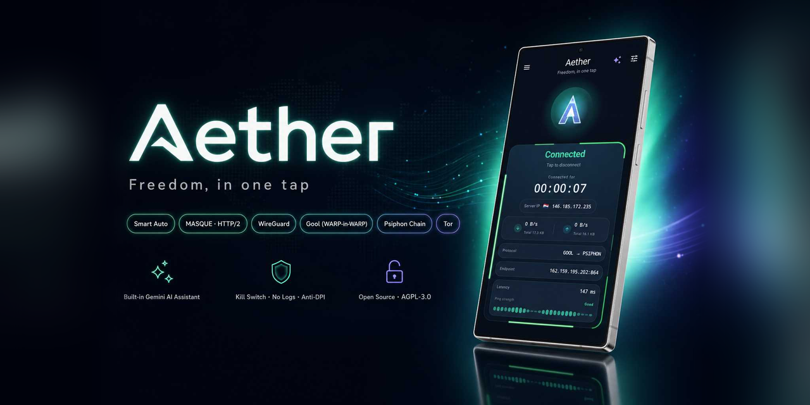

> **1.7.0:** [Release notes](.github/release-notes.md) · [Detailed notes](docs/RELEASE_1.7.0.md) · [Changelog](CHANGELOG.md)

<p align="center">
  
</p>

<h1 align="center">Aether Mobile</h1>

<p align="center">
  A dark <b>Material You</b> Android VPN client with the Aether engine, Tor, Psiphon
  and Xray built <b>inside the app</b>.
</p>

<p align="center">
  <a href="README.md">🇬🇧 English</a> · <a href="README.fa.md">🇮🇷 فارسی</a>
</p>

<p align="center">
  
  
  
  
</p>

---

## Contents

- [Overview](#overview)
- [Features](#features)
- [Connection modes](#connection-modes)
- [What is new in 1.7.0](#what-is-new-in-170)
- [What is new in 1.6.0](#what-is-new-in-160)
- [Custom configs (V2Ray / Xray / NapsternetV)](#custom-configs-v2ray--xray--napsternetv)
- [Clean-IP scan settings](#clean-ip-scan-settings)
- [Getting started](#getting-started)
- [Settings guide](#settings-guide)
- [Quick Settings tile and widget](#quick-settings-tile-and-widget)
- [Sharing the VPN with other devices](#sharing-the-vpn-with-other-devices)
- [Gemini AI assistant](#gemini-ai-assistant)
- [Privacy: where your traffic goes](#privacy-where-your-traffic-goes)
- [Security audit](#security-audit)
- [Updates and app signing](#updates-and-app-signing)
- [Building](#building)
- [Requirements](#requirements)
- [Changelog](#changelog)
- [Credits and license](#credits-and-license)

## Overview

Aether Mobile runs the Aether engine on the phone and brings up an Android
`VpnService`. A built-in tunnel core (`hev-socks5-tunnel`) forwards every packet
from the VPN interface into the engine's local SOCKS5 proxy, so no second app
(such as v2rayNG) is needed.

```text
Your apps ─► Android VPN (TUN) ─► hev-socks5-tunnel ─► 127.0.0.1:1819 ─► Aether engine ─► Internet
```

The engine connects to Cloudflare WARP (WireGuard or MASQUE), and can add Tor
(arti, built into the engine) and Psiphon as further hops. Your own V2Ray / Xray /
NapsternetV configs run in a bundled Xray-core, alone or chained with the engine.

## Features

- **Material You dark UI** (Jetpack Compose) with dynamic colour on Android 12+,
  English and Persian with automatic RTL.
- **Six engine modes:** Aether, `Aether → Psiphon`, Tor, `Aether → Tor`,
  `Tor → Psiphon`, `Tor → Aether`.
- **Custom configs:** VLESS, VMess, Trojan, Shadowsocks, SOCKS, WireGuard and
  NapsternetV (`.npvt` / NPVS), alone or in 14 chains with the engine, organised in named tabs.
- **Smart protocol selection** (rewritten in 1.7.0): tests WireGuard and MASQUE side by
  side from the same instant, light tactics before heavy ones, measures latency, download,
  upload and overhead of every route that works, connects the best one and remembers it per
  network.
- **Full engine options:** protocol (Smart / MASQUE / WireGuard / Gool / MASQUE×2),
  scan mode, IP version, obfuscation (Noize), manual endpoint or scan range,
  keepalive, MTU, TLS fragmentation, ECH, MASQUE over HTTP/2, quick reconnect,
  Tor bridges, Psiphon exit country.
- **Routing:** per-app split tunnelling, domain/IP rules (tunnel / direct / block),
  smart routing lists, kill switch, IPv6 leak protection, proxy mode.
- **Cloudflare Zero Trust** enrolment (service token, e-mail code or enrolment token).
- **VPN sharing** over Wi-Fi or hotspot (HTTP, SOCKS5 and PAC), with setup pages
  for the other devices.
- **Quick Settings tile** and a **home-screen widget**.
- **Optional Gemini AI assistant** for settings advice, explanations and chat.
- **Encrypted local diagnostics log** and settings, sealed with an Android Keystore key.

## Connection modes

| Mode | Path | Use it when |
|------|------|-------------|
| **Aether** | phone → WARP | Default; fastest |
| **Aether → Psiphon** | phone → WARP → Psiphon | You need a foreign exit IP or a chosen exit country |
| **Tor** | phone → Tor | You want Tor's anonymity (TCP only; DNS is resolved inside Tor) |
| **Aether → Tor** | phone → WARP → Tor | Tor is blocked on your network; Tor is reached through WARP |
| **Tor → Psiphon** | phone → Tor → Psiphon | Psiphon exit with Tor in front |
| **Tor → Aether** | phone → Tor → WARP | WARP exit reached through Tor |

## What is new in 1.7.0

App version **1.7.0** (version code 20), engine core **2.4.0**. This release is about one
thing: **connecting reliably, first time, without touching a setting** - especially in
Tehran, where only MASQUE gets through.

**Smart anti-DPI brain, smart connection gate, damaged-identity fix (same version, 1.7.0 / 20)**

- **The custom-config verification switch is gone too:** every session - built-in or custom, alone or
  chained - passes the same smart gate, and a "Smart connection gate" information card (same block as the
  desktop app) replaces the switches in Settings → Connection and Custom configs. The connecting state now
  reads "Smart gate: waiting for real data…". Security audit of this release: **89/100**
  (see `release-notes.md`).
- **Smart brain (`core/DpiBrain.kt`).** Smart mode now reads the engine's own log while it
  connects and works out what the operator's DPI is doing: UDP silently dropped, TLS
  handshakes reset, gateways IP-filtered, the account API unreachable, a damaged identity.
  Both race lanes share what they learn, and the tactics still to come are re-planned on the
  spot - TCP carriers move ahead of UDP ones, TLS fragmentation and a stronger obfuscation
  floor are switched on, hopeless UDP rungs are abandoned after 7 s instead of their whole
  budget, equivalent tactics are never tried twice. What finally worked is remembered per
  network **and per operator** (a truncated hash, never the operator name), so a new network
  of the same operator starts with it. Nobody has to open a settings page.
- **"Verify connection" removed - replaced by the always-on smart gate (`core/LiveDataProof.kt`).**
  With the switch on, MASQUE never connected (the old gate demanded a geolocation answer AND
  device DNS over SOCKS5 UDP for up to 90 s); with it off, nothing proved that data flowed.
  Now every engine session (Aether, Psiphon, Tor and every chain) is reported Connected only
  after a real HTTP request crossed the tunnel and its answer came back - usually within a
  second. A bare SOCKS5 reply never counts, so a fake connection cannot pass. Device DNS over
  UDP is still measured for the diagnostics panel but no longer blocks. Race lanes are
  proven the same way. Custom configs pass the same smart gate - their switch was removed too, and an information card replaces it.
- **Root cause of "the engine stops 0.4 s after every start, on every protocol" fixed.** Field
  log (IR-MCI): `Error: Io(InvalidData, "stream did not contain valid UTF-8")`. Two identity
  seal passes could run at once (a second `stop()` of an already-reaped engine decremented
  the running counter of a live one) and one sealed the random bytes the other was shredding;
  from then on every start restored the noise and died. Fixed three ways: the vault is
  serialised and never seals or restores anything that is not UTF-8 text, an engine
  instance can release its running count only once, and the engine core itself
  (`config.rs`, `AETHER-APP-PATCH identity-not-utf8`) now quarantines a non-UTF-8 identity and
  provisions a fresh one instead of exiting. The brain heals a damaged identity and retries
  the same tactic once.
- **Faster Smart connects:** quality window 3.5 s → 2.5 s, route measurement 7 s → 4.5 s.
- What's new dialog: new bullets, notice revision `r5` (shown once more). Version stays
  1.7.0 / 20. Tests: `DpiBrainTest`, `IdentityVaultUtf8Test`, `test-functional-wiring.py`.

**Root cause of the connection failures (fixed)**

- **The engine was killed while it was still working.** The engine binds its local SOCKS5
  port the moment it starts and only *serves* it once a tunnel is validated. The app took the
  open port (≈0.3 s after launch) for a ready engine and gave every attempt a single 4-second
  SOCKS5 handshake. Verifying a cached MASQUE gateway alone takes 2-3.5 s on Iranian links, a
  fresh scan much longer - so MASQUE failed "sometimes" and every scan failed always. Both
  Tehran field logs show every attempt dying exactly 4.0 s after the port opened.
- **New readiness gate:** the app now waits - for the attempt's whole budget - until the
  engine itself reports that it serves SOCKS5 and a real handshake succeeds, and stops
  waiting the instant the engine exits. A working route is detected within ~150 ms of being
  ready; a dead engine still fails in milliseconds. This applies to manual protocols, Smart
  mode, chained stage 1, and engine restarts by the supervisor.

**Smart mode, rewritten: a fair race and the best route, not the first one**

- **Fair start:** both identity families - WARP (WireGuard) and MASQUE - start **at the same
  instant** with the **same per-tactic budgets** (light 20 s, hardened 25 s, two-hop 40 s).
  1.6.0 started WireGuard first, MASQUE 7 s later, and before that gave a remembered route a
  serial 45 s slot.
- **Light to heavy:** each lane starts with the cleanest, lowest-overhead tactic (bare
  WireGuard, MASQUE over HTTP/3 or HTTP/2) and escalates only when needed (Noize obfuscation,
  TLS-fragmented HTTP/2, then the two-hop Gool and MASQUE×2).
- **Best route wins:** after the first route proves it carries traffic, the race keeps
  running for 3.5 s so the other lane can prove one too. Every proven route is then measured
  through itself - **latency** (best of three round trips), **download** (≈384 KB) and
  **upload** (128 KB) over verified TLS - and ranked with an **overhead factor** per protocol.
  The best one becomes the session; if it does not come up, the next proven route is tried.
- **HTTP/2 first where it matters:** MASQUE over HTTP/2 (TCP) leads on mobile data, on an
  Iranian SIM (MCC 432, on Wi-Fi too), on UDP-throttled networks, and when a new QUIC
  probe (a Version-Negotiation packet to the MASQUE gateways) gets no answer.
- **Per-network memory** now only re-orders a lane (the proven route leads it); failures of
  every lane are recorded so the next connect on that network starts smarter.
- **Last resort** only if nothing proved itself: a deep full-range scan of the two cleanest
  carriers, instead of replaying the whole ladder.

**Other fixes**

- **ECH crash:** the anti-DPI passes no longer switch ECH on by themselves. Where no ECH key
  can be fetched (Iran today) the engine refuses to start
  (`ECH is on but there is no ECH key to offer`), which made every hardened MASQUE attempt die
  0.4 s into a 150 s budget. ECH is now only ever your own choice.
- **Identity clash:** core 2.4.0's Gool is WireGuard *inside MASQUE* and uses the MASQUE
  identity and gateway cache, but it raced in the WARP lane next to MASQUE. It now runs in the
  MASQUE lane (classic Gool stays in the WARP lane).
- **Wrong scan ranges:** the serial Smart ladder narrowed MASQUE and Gool scans to the ranges
  measured for WireGuard (e.g. `8.6.112.0/24`, not a MASQUE range). Narrowing now applies to
  WireGuard only; MASQUE uses the engine's own gateway list.
- **Missing carrier:** MASQUE over HTTP/2 was absent from the ladder of "open" networks. The
  ladder is now built from the same tactic catalogue as the race, families interleaved.
- **Manual MASQUE:** three passes - as configured, then MASQUE over HTTP/2 (TCP), then the
  anti-DPI pass (HTTP/2 + TLS fragmentation + obfuscation).
- **Clearer messages** in the log (`engine-serving`, `died-before-serving reason=...`,
  per-route latency / speed / score) and in the UI.
- **What's new dialog** now shows the 1.7.0 list and keeps the *"If you cannot connect at
  all"* steps; preset exports are tagged 1.7.0 and 1.6.0 exports still import.
- **Connect button "does nothing" (same-version fix, reported on a Galaxy S24 Ultra):** a tap on
  Connect first needs Android's VPN consent. When the system refused it without showing the
  consent screen - another app set as *Always-on VPN*, a work profile / Secure Folder / device
  policy, or a screen overlay blocking the *OK* button - the app ignored the result, so the button
  looked dead while the IP was still shown. Now the refusal is shown on the home screen, logged in
  Diagnostics, and a dialog explains the cause and opens the VPN settings. A consent granted after
  the activity was recreated (rotation, display-size change) no longer loses the tap. The What's
  new dialog lists this fix and is shown once more.

**Same-version improvements (1.7.0, version code 20)**

- **Faster auto-select.** The first connect no longer waits for every config to be measured: the
  session starts on the first fast server that answers and switches to the overall fastest one as
  soon as the full test ends, so a dead or slow config no longer stretches the connect. "Test all"
  switches a live session to the fastest server at once, and a network change (Wi-Fi, mobile data,
  another SIM) measures again and re-selects.
- **One-tap actions on every config:** ping, speed test and delete without opening the config menu.
- **Speed test all** (download / upload, one server after another, failed servers skipped) and
  **sort by** ping, download speed or upload speed.
- **Interactive connection card:** tap the latency row for last / min / max / average, jitter and
  packet loss (plus a 10-probe burst); the pipeline row for every node of the chain and its role; the
  traffic row for the apps using the internet right now (Android "Usage access", granted by the user).
- **Unified connection chain:** Settings → Connection starts with a chain builder - number of nodes,
  then the core of each node (Aether, Psiphon, Tor or a config); a node's settings show only that
  core's options (Aether also links to Transport & anti-DPI, Config to Custom configs).
- **Send diagnostics:** crashes and failed connections can be reported to the developers' GitHub
  with one tap. The report is redacted (no IPs, servers or keys), copied to the clipboard and filed
  by the user on the issue page - no server, no token. A switch in Settings turns it off.
- New permission: `PACKAGE_USAGE_STATS` (special access, only used after the user grants "Usage
  access", only for the per-app traffic list; nothing leaves the device).

## What is new in 1.6.0

App version **1.6.0** (version code 19), engine core **2.4.0**.

**Configs and tabs**

- **One import flow** for links and files, including hosted config lists (stored
  encrypted, refreshed atomically; a failed download or parse keeps the previous data).
- **Named tabs:** *All*, automatic *V2Ray* / *Npvt* tabs and your own tabs with
  counters, rename (pencil) and move; deleting a tab never deletes its configs.
- **New table:** ping and status beside the name, a menu on every server, a visible
  scrollbar, successful pings sorted ascending and green / amber / red ping colours.
  The *Highest latency first* switch now sits directly under *Health-check interval*.
- **NPVS v5** (authenticated compact envelopes) next to NPVT1, with the author's
  expiry and mobile-only rules. Other NPVS generations and device-bound files are refused.
- **Open files from other apps:** a separate import screen validates the file, asks
  for a password and destination tab, and needs your confirmation. It never starts a VPN.
- **Certificate pinning:** a separate leaf-pinning Xray executable; if it is missing
  a pinned config fails closed instead of ignoring the pin.

**Connection and chains**

- **Auto-select** in the running VPN service: 1 / 3 / 5 / 10 / 30 / 60 minutes,
  fresh successful results only, 50 ms / 20 % hysteresis. Switching reconnects briefly.
- **Real delay** uses the v2rayNG default HTTPS 204 target, validates the certificate
  and refuses error, redirect and captive-portal answers.
- **Connection verification** is a switch for the six ordinary modes, separate from the
  custom-config verification; start-up and liveness checks stay active.
- **Config → Aether / Aether → Config** repaired (TCP-aware carrier, real exit port,
  SNI-safe routing); the home screen shows the real exit.
- **Speed test, presets and connection sounds**, engine core 2.4.0 TLS / API options.

**Profiles (save, import and export)**

- **Profile management.** Save your current settings as a new profile with one tap, switch between profiles whenever you like, import settings from a file, and export the selected profile in a non-confidential form to share it with friends. The exported file leaves out your sensitive data, so you can hand it over without worrying about leaking private information.

**Clean-IP scan**

- **New Clean-IP scan.** The app now finds a clean IP by itself; no separate IP-scanner app is needed. For configs hosted on Cloudflare (for example BPB panels), when a V2Ray server's ping rises or the server stops working, tap the magnifier icon, or open the three-dot menu and choose *Clean IP*, next to that server to start a scan. Once a clean IP and port are found, the app replaces the address automatically and updates the server. The *Scan clean IPs of this tab* button scans every server of the tab one after another. **Important:** scan speed depends on your network. Always scan with the VPN turned off. If a message says no suitable IP was found, repeat the scan a few more times. In the *Clean IP* settings you can change the scan depth or enter your own IP range.
- **Clean-IP result cards stay on screen until you tap the X.**

**Display and sound**

- **Home screen animations** switch: turns off the blue glow around the connect button and the other
  moving home-screen effects on weaker phones (the connect button still spins while connecting).
- **Connection sounds** switch: turns the short cue on connect and disconnect on or off; silent mode is respected.

**Assistant and polish**

- Gemini uses the active session's final endpoint and never sees the private config vault.
- The onboarding pager is gone; the *What's new* dialog and *Messages & announcements* remain.
- A stable-key tab strip fixes the tab-index crash.

## Custom configs (V2Ray / Xray / NapsternetV)

Open **Settings → Custom configs** and switch the section on. With it off (the
default), every session uses the engine modes above.

### Importing

- **Paste from clipboard:** one or many links, links inside a longer text (for
  example a Telegram message), a base64 hosted config list, an `https://` hosted config list
  URL or a full Xray JSON config.
- **Pick a file:** `.npvt`, `.npvs`, `.txt`, `.json` or a QR image. Files opened from other apps go through a confirmation screen.
- **Scan a QR code** with the camera, or **read a QR code from an image**.

Supported protocols: VLESS (including REALITY and XTLS Vision), VMess, Trojan,
Shadowsocks, SOCKS and WireGuard. Transports: TCP/raw, WebSocket, gRPC,
HTTPUpgrade, XHTTP and mKCP, with TLS or REALITY.

**NapsternetV (`.npvt` files and `npvt://` links)** are decrypted on the device and
every server inside becomes its own config. The author's restrictions are kept: a
locked config can be used, chained, renamed and deleted but its server and keys
are never shown; password-protected files ask for the password; expiry dates and
"mobile data only" are enforced; device-bound files are refused.

### Managing configs

Each saved config can be selected, edited, renamed, copied as a link, tested and
deleted. **Test delay** is a real delay test, as in v2rayNG: the config is started
in Xray-core and an HTTP request (`generate_204`) is sent *through* it, so REALITY,
uTLS fingerprints, transports and the config's credentials are all exercised. The
result is shown in milliseconds; a failure shows `-1` with a diagnosis:
**No response** (the server accepts TCP but the config gets no answer: wrong or
expired key, or the protocol is filtered), **Server off / unreachable**,
**Filtered** (sinkhole or dropped TCP) or **Invalid config**. **Test all** checks
every config at once. Every result is written to the diagnostics log. Configs are
stored encrypted.

### Chains

The config can sit in front of the engine (the engine dials through it) or after
the engine's exit (the config is dialled through the engine):

| Single | Double | Triple |
|---|---|---|
| `Config` | `Config → Aether` · `Aether → Config` | `Config → Aether → Psiphon` · `Config → Aether → Tor` |
| | `Config → Psiphon` · `Psiphon → Config` | `Config → Tor → Psiphon` · `Config → Tor → Aether` |
| | `Config → Tor` · `Tor → Config` | `Aether → Psiphon → Config` · `Aether → Tor → Config` |
| | | `Tor → Psiphon → Config` · `Tor → Aether → Config` |

The config is always at one end of a chain. The home screen shows the running
chain, for example `VLESS → Aether(WireGuard)` or `Npvt → Tor`.

Tips:

- `Config → Tor …` chains need a few minutes on the first connect while Tor
  downloads its directory through the config; later connects reuse it.
- `Psiphon → Config` needs Psiphon itself to reach its network from your
  connection. If Psiphon alone does not connect, use `Config → Psiphon` instead.

## Getting started

1. Install the APK (see [Building](#building) for which one) and open the app.
2. Tap the connect button. Android asks once for VPN permission.
3. The pipeline row on the home screen shows the active path; a tick appears
   when traffic is flowing.
4. Change the mode from the mode selector on the home screen, and fine-tune with
   the tune button (top right) or the side menu → **Settings**.

## Settings guide

| Setting | What it does |
|---------|--------------|
| **Protocol** | Smart (recommended), MASQUE, WireGuard, Gool (WireGuard over MASQUE, or classic WireGuard over WireGuard), MASQUE×2 |
| **Scan mode** | How endpoints are searched: Turbo, Balanced, Thorough, Stealth, Ironclad |
| **IP version** | IPv4, IPv6 or both for the WARP endpoint |
| **Obfuscation (Noize)** | Off, Light, Firewall, Balanced, GFW, Aggressive |
| **Manual endpoint / scan range** | Pin one endpoint or limit scanning to your own range |
| **MTU, keepalive** | Tunnel packet size and keepalive interval |
| **TLS fragmentation, ECH, MASQUE over HTTP/2** | Options for networks that filter TLS or QUIC |
| **Tor bridges** | Auto (bridges only when plain Tor fails), Always, Off |
| **Psiphon exit country** | Exit country for modes that end in Psiphon |
| **Split tunnelling** | Only the selected apps, or all apps except the selected ones |
| **Routing rules** | Send domains / IP ranges through the tunnel, direct, or block them |
| **Kill switch / IPv6 leak protection** | Block traffic outside the tunnel |
| **Proxy mode** | Run the engine as a local proxy without the VPN interface |
| **Zero Trust** | Join a Cloudflare Zero Trust organization instead of consumer WARP |
| **Core log level** | Detail of the engine log in *Diagnostics* |

Every option has an information icon that explains what it does.

## Quick Settings tile and widget

1. Pull down Quick Settings, tap the edit (pencil) button and drag the **Aether**
   tile into your tiles.
2. Tap the tile to connect, tap again to disconnect. The first connection must be
   started from the app so Android can show the VPN permission dialog.

The home-screen widget shows the connection state and connects or disconnects
with one tap.

## Sharing the VPN with other devices

1. Connect the VPN.
2. Side menu → **Share VPN** → choose **Home Wi-Fi** or **Mobile hotspot** and turn
   sharing on.
3. On the other device, use the addresses shown in the app:
   - **HTTP proxy:** `<phone-ip>:10809`
   - **SOCKS5 proxy:** `<phone-ip>:10808`
   - sign in with the user name and proxy password shown in the app
   - or open `http://<phone-ip>:10811/` in its browser for step-by-step setup
     (Windows, macOS, Android, iPhone, Firefox, TV) and the PAC address.
4. `http://aether.check/` on the other device confirms that it is using the tunnel.

> ⚠️ Devices on the same network can reach the proxy while sharing is on. Use it on
> networks you trust; **Generate a new password** revokes old access. Sharing
> stops when the VPN disconnects.

## Gemini AI assistant

Optional and off until you add a key.

1. Get a free key from [Google AI Studio](https://aistudio.google.com/apikey).
2. **Settings → Assistant** → paste the key → **Test the API connection** → pick a model.
3. Use it for:
   - **Settings advisor:** reads a redacted excerpt of this session's log and
     suggests settings; nothing changes until you tap **Apply**.
   - **AI icons** next to each setting with an explanation in your language.
   - **Chat** (Assistant → Chat, or the AI button on the home screen).

The key is stored encrypted in the Android Keystore. Credentials and public IP
addresses are removed from anything sent. The assistant can only change tuning
options (protocol, scan mode, obfuscation, MTU, timings and similar); it can never
change the mode, routing, split tunnelling, sharing or Zero Trust credentials.
Changes apply on the next connect.

AI requests go through the tunnel, so the assistant works only while connected
in `Aether → Psiphon` mode (Google's AI endpoints refuse WARP exit addresses).

## Privacy: where your traffic goes

- Traffic is encrypted on the phone (WireGuard or MASQUE) and leaves through
  Cloudflare WARP; with Tor or Psiphon in the chain it leaves through their networks;
  with a custom config, through the server of that config.
- The app has no accounts, analytics or developer servers.
- As with any VPN, the operator of the exit network can see traffic that is not
  end-to-end encrypted (HTTPS stays encrypted).
- The diagnostics log stays on the phone and is encrypted.

Details: [docs/ZERO_TRUST.md](docs/ZERO_TRUST.md),
[docs/SECURITY_AUDIT_1.5.0.md](docs/SECURITY_AUDIT_1.5.0.md).

## Security audit

**1.6.0 — 76 / 100** (full 0–100 static audit, eight weighted areas; no dynamic phone test and no
live `cargo audit` were possible). The table is in [.github/release-notes.md](.github/release-notes.md)
(English and Persian). The previous review, 1.5.0 — 92 / 100
([docs/SECURITY_AUDIT_1.5.0.md](docs/SECURITY_AUDIT_1.5.0.md)), used a looser method, so the two
numbers are not directly comparable. Highlights:

- **Unchanged:** permissions, `allowBackup="false"`, cleartext traffic denied, system CA anchors only.
- **Improved (applied by CI at build time; the committed `Cargo.lock` still lists 0.11.17 / 0.23.43):** `quinn-proto` 0.11.18 and `rustls` 0.23.46; strict `cargo audit` in CI
  (unresolved vulnerabilities fail the build); complete Gradle Wrapper with distribution checksum.
- **Watch items:** the Clean-IP scanner probes candidate IPs with a trust-all TLS context
  (by design, validated afterwards through a real-proxy ping); `ConfigImportActivity` is
  exported with a broad MIME filter (it validates, asks and never connects); local chain
  SOCKS ports and LAN sharing have no password by default; R8 is off; the signing key
  in the repository guarantees updatability, not authenticity.
- No packet capture on a phone was done. For the strongest kill switch enable Android's
  *Always-on VPN* and *Block connections without VPN*.

## Updates and app signing

A new APK installs over the old one only when both are signed with the same key.
CI signs every release with one stable key:

- with your own keystore when these repository Secrets are set (recommended):

  | Secret | Meaning |
  |--------|---------|
  | `KEYSTORE_BASE64` | The `.jks` keystore, base64-encoded (`base64 -w0 my-release-key.jks`) |
  | `KEYSTORE_PASSWORD` | Keystore password |
  | `KEY_ALIAS` | Key alias |
  | `KEY_PASSWORD` | Key password |

- otherwise with the CI keystore kept in `.github/ci-keystore.jks.b64`. Keep that
  file in the repository; deleting it creates a new key and the next update will
  need an uninstall.

A keystore committed to a public repository only guarantees updatability, not
authenticity. See [docs/SIGNING.md](docs/SIGNING.md) and
[docs/PLAY_PROTECT.md](docs/PLAY_PROTECT.md).

## Building

### On GitHub Actions (no local setup)

1. Push this folder to a GitHub repository and enable Actions.
2. Every push to `main` builds and tests the app. For a release, push a tag:

   ```bash
   git tag v1.7.0
   git push origin v1.7.0
   ```

3. The release contains up to four APKs; its text comes from `.github/release-notes.md`.

| File | For |
|------|-----|
| `Aether-1.7.0-arm64-v8a.apk` | Almost all modern phones (64-bit ARM) |
| `Aether-1.7.0-armeabi-v7a.apk` | Older 32-bit phones |
| `Aether-1.7.0-universal.apk` | Any ARM phone — choose this if unsure |
| `Aether-1.7.0-x86_64.apk` | x86_64 devices and emulators |

### Native components

- `scripts/fetch-natives.sh` fetches `hev-socks5-tunnel`.
- `scripts/build-natives.sh` builds `libhev-socks5-tunnel.so` with `ndk-build`, the
  Aether engine (`native/aether`, with Tor) with `cargo-ndk`, and installs
  Xray-core as `libxray.so` from the official release, verified by SHA-256.
- CI refuses an APK that lacks any native component for an included ABI.
- `scripts/sync-core.sh` is an inert stub: the automatic core update from GitHub was
  removed in 1.6.0; the vendored engine (`native/aether`, core 2.4.0) only changes with a release.

### Locally

JDK 17, Android SDK 35, NDK 26.3, Rust with `cargo-ndk`, Go 1.22 and Gradle 8.9:

```bash
bash scripts/build-natives.sh
gradle :app:testReleaseUnitTest
gradle :app:assembleRelease
```

A release build needs a keystore (`scripts/generate-keystore.sh`, see
[docs/SIGNING.md](docs/SIGNING.md)).

## Requirements

- Android 8.0 (API 26) or newer, ARM (`arm64-v8a` or `armeabi-v7a`).
- Permissions: VPN (standard Android consent), notifications (connection status),
  camera (only when scanning a QR code).

## Changelog

The full history is in [CHANGELOG.md](CHANGELOG.md).

<!-- core-sync:en -->

## Credits and license

- [CluvexStudio/Aether](https://github.com/CluvexStudio/Aether) — the engine
- [heiher/hev-socks5-tunnel](https://github.com/heiher/hev-socks5-tunnel) — the tunnel core
- [Arti](https://gitlab.torproject.org/tpo/core/arti) — Tor implementation in the engine
- [Psiphon](https://github.com/Psiphon-Labs/psiphon-tunnel-core)
- [Xray-core](https://github.com/XTLS/Xray-core) — custom configs

Third-party licences: [THIRD_PARTY_NOTICES.md](THIRD_PARTY_NOTICES.md).
Released under **AGPL-3.0**. See [LICENSE](LICENSE).

## Clean-IP scan settings

Settings has a dedicated scan-depth and manual real-ping limit page, shared by
single-server and current-tab group scans. The active server row shows progress;
a bottom result card reports the old/new endpoint and confirmed ping and stays until you close it with the X button. Locked or
stale configs are not overwritten. See [scanner settings and runtime limits](docs/CLEAN_IP_SCANNER.md).
